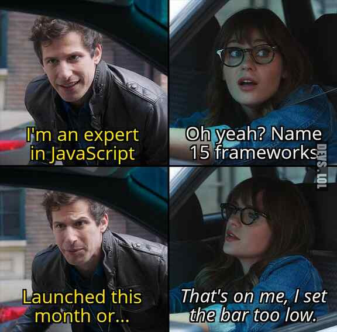
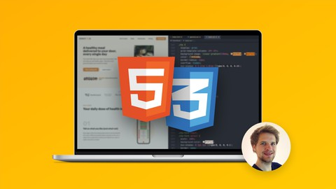
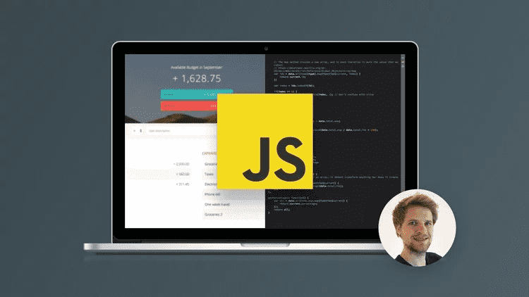

+++
outputs = ["Reveal"]
weight = 4
+++

{}



  PART ONE · WHERE I LIVE
  <h2 class="t-huge">Softwareengineering.</h2>
  
Frontend, backend, and AI. The paths I know from the inside.

{}
**0:09 · Part door.** "I'll go deeper on the ones I do every day. Then I'll show you the others, lighter, because I don't do them every day." ↓
{}

---



  

    

      2017
      <h2 class="t-big">The juniorbar.</h2>
      
Five skills got a software engineer hired.

    

    

      

        Spring / Node · Real projects
        Extra mile
      

      

        
        2017 · HIRED
      

      

        
One language

        
Problem solving (DSA)

        
OOP

        
Databases

        
Soft skills

      

    

  

{}
**0:10 · 2017 · Six clicks (Space or ↓).** Say it clearly: "This bar is for software engineering. Every path has its own bar."
- Clicks 1–5 reveal each foundation skill under the `2017 · HIRED` bar: one language, problem solving (DS & Algos), OOP, databases, soft skills.
- Click 6 drops `Spring / Node · Real projects` *above* the bar. That used to be the extra mile that made you stand out.
- Next click ↓ animates the shift to 2026.
{}

---



  

    

      2026
      <h2 class="t-big">The juniorbar moved.</h2>
      
The foundation stayed. Bonus became baseline.

    

    

      

        
        2026 · HIRED
      

      

        
03Prove it’s right

        
02Explain it out loud

        
01Use AI on purpose

      

      

        Spring / Node · Real projects
        Now expected
      

      

        
        2017 bar
      

      

        

          The Foundation
          Still required
        

        

          
One language

          
Problem solving (DSA)

          
OOP

          
Databases

          
Soft skills

        

      

    

  

{}
**0:11 · Three clicks (Space or ↓) fill the gap.**
- Those five didn't disappear. They became **the foundation**. Still tested in every interview.
- Yesterday's extra mile (Spring, Node, a real project) dropped *below* the bar. AI scaffolds a CRUD app in an afternoon, so having one is no longer a bonus.
- Each amber block used to be a senior expectation. Now it's the junior bar.
- Bridge ↓: "So what does a software engineer actually build? Two sides. The side you see, and the side you don't."
{}

---



  

    

      FRONTEND
      <h2 class="t-huge">Frontend.</h2>
      
Everything you see and click.

      

        
<b>HTML</b>What’s on the page

        
<b>CSS</b>How it looks

        
<b>JavaScript</b>What it does

      

    

    

      
<i></i><i></i><i></i>mansaf.jo

      

        
<b>Mansaf &amp; Co.</b>Cart <em class="fe3-count"><u>0</u><u>1</u></em>

        
<b>Dinner in two taps.</b>Fresh mansaf, at your door in 30 minutes.

        

          
<i></i><b>Mansaf</b>8 JOD<button class="fe3-btn" tabindex="-1">Add</button>

          
<i></i><b>Maqluba</b>7 JOD<button tabindex="-1">Add</button>

          
<i></i><b>Knafeh</b>3 JOD<button tabindex="-1">Add</button>

        

      

      Added to cart
    

  

  

    &nbsp;
    &nbsp;
    &nbsp;
  

{}
**0:12 · Frontend · Three clicks: HTML, then CSS, then JavaScript.**
- "Frontend is everything you see and click. The minimal stack is three things."
- Click 1, HTML: the content and structure. Plain, ugly, but it's all there.
- Click 2, CSS: the same page, styled. Colors, layout, fonts.
- Click 3, JavaScript: now it does something. Click Add, the cart updates.
{}

---

  

    

      THEN
      <h2 class="t-big">Pick oneframework.</h2>
      
<code>count(framework) = 1</code>

      

        React
        Angular
        Vue
      

    

    
  

{}
**0:13 · Frameworks (30 sec).**
- A framework is ready-made code for the boring, repeated parts, so you can build real apps faster.
- The meme is true. There's a new one every week. Don't chase them. Pick one: React, Angular, or Vue. Where count(X) = 1.
- Learn JavaScript well first. Frameworks are much easier after.
{}

---

  WHERE I’D START
  <h2 class="t-big">Two courses I trust.</h2>
  

    <a class="course in d3" href="https://www.udemy.com/course/design-and-develop-a-killer-website-with-html5-and-css3/"><b>Build Responsive Real-World Websites with HTML and CSS</b>HTML and CSS</a>
    <a class="course in d4" href="https://www.udemy.com/course/the-complete-javascript-course/"><b>The Complete JavaScript Course: From Zero to Expert!</b>JavaScript</a>
  

{}
**0:14 · Courses (20 sec).** Both by Jonas Schmedtmann on Udemy. Wait for a sale, they're cheap. Then build one real page. A course without a project doesn't count.
{}

---



  

    <h2 class="t-big" style="font-size:122px;">How appscall each other.</h2>
    
The frontend asks. The backend answers. They speak APIs.

  

  

    

      Frontend · App or website
      POST /login
    

    

      
    

    

      Backend · API
      Checks DB
    

  

  

    

200

OK

    

401

Who are you?

    

404

Not here

    

500

We broke it

  

{}
**0:14 · APIs, the bridge between the two sides (one minute).**
- Walk one example everyone knows: tap Login → your phone sends `POST /login` to a server → the server checks the database and answers `200` (let them in) or `401` (wrong password).
- Frontend people and backend people meet here every day. Mobile apps and AI tools use the same thing.
{}

---



  

    

      BACKEND
      <h2 class="t-huge">Backend.</h2>
      
Everything behind the screen.

      
The logic, the data, the security. It runs on servers, not in your browser.

    

    

      
You tapped<b>Pay 8 JOD</b>

      
<i></i>Check who you are<em>12 ms</em>

      
<i></i>Check the price<em>4 ms</em>

      
<i></i>Charge the card<em>310 ms</em>

      
<i></i>Save the order<em>9 ms</em>

      
<i></i>Send the receipt<em>21 ms</em>

      
All of this before the screen says <b>Done.</b>

    

  

{}
**0:15 · Backend · the side you don't see.**
- "You tap Pay. Half a second later it says Done. In that half second the backend did all of this."
- Each line is code someone wrote, tested, and gets paged for at 3 AM if it breaks. That's my job.
{}

---

  

    

      <h2 class="t-huge lang-title">Java</h2>
      
is enough.

      
+ SQL

      
The language is not the point.

    

    
SELECT u.name, o.total FROM users u JOIN orders o &nbsp;&nbsp;ON o.user_id = u.id WHERE o.total &gt; 100;

  

  

    &nbsp;
    &nbsp;
    &nbsp;
    &nbsp;
  

{}
**0:16 · One language + SQL · four clicks (Space or ↓).**
- "What's the backend stack? It depends." Opens on Java. Each click: red strike, then the next language.
- Java → JavaScript → Rust → Go → **One language** + "The language is not the point."
- Land it: "Pick one. Go deep. Plus SQL, because almost every real app stores data in a database."
{}

---



  EVERY LANGUAGE HAS ITS FRAMEWORK
  <h2 class="t-big">Pick one. Learnits framework.</h2>
  

    
Java<b>Spring</b><em>What I use</em>

    
JavaScript<b>Node.js</b>

    
Python<b>Django</b>

    
C#<b>ASP.NET</b>

    
Go<b>Gin</b>

    
PHP<b>Laravel</b>

  

{}
**0:17 · Language and framework pairs (30 sec).**
- Same idea as frontend: the framework does the boring parts so you build the real thing.
- "I use Java and Spring every day. Any of these gets you hired. Pick the one your first project needs."
{}

---



  AND THEN
  <h2 class="t-huge">AI. AI. AI!</h2>
  

    


01<b>Use AI</b>
Every path. Every job. To learn faster and build faster.
<em>Everyone</em>

    


02<b>Build with AI</b>
Products on top of models. LLM APIs, MCP, agents.
<em>AI engineering</em>

    


03<b>Build the AI</b>
Train the models. Math, statistics, research.
<em>Machine learning</em>

  

{}
**0:18 · Three kinds of AI work · Three clicks.**
- 1 Use AI: not a path, a skill. Every path on that quiz uses it now.
- 2 Build with AI: you take a model and build a product with it. Software engineering plus AI. This is what EG Wizard is. You'll see it in a minute.
- 3 Build the AI: machine learning. Training the models themselves. Strong math, often a master's. Worth it if you love it.
- "My last talk went deep on the AI stack. Slides are at present.bynoor.io/ai-swe-2026."
- Bridge →: "Enough theory. Here's what the job actually looks like."
{}

{}
